<div align="center">

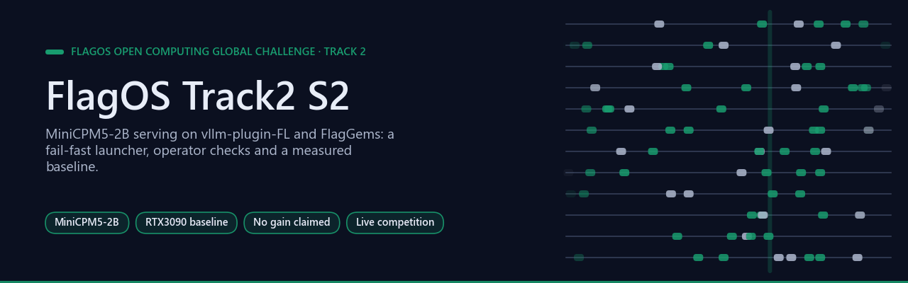

# FlagOS Season 2, Track 2: measured MiniCPM5-2B optimisation

[](https://github.com/Agnuxo1/FlagOS-Track2-S2/actions/workflows/checks.yml) [](LICENSE)   [](evidence/rtx3090-baseline-20261028) [](https://www.kaggle.com/competitions/flag-os-open-computing-global-challenge-track-2)

[**Actual state**](#actual-state-28-october) · [**Reliability**](#applied-reliability-improvements) · [**Experiments**](#three-prespecified-experiment-directions) · [**Reproduce**](#reproduce) · [**Baseline evidence**](evidence/rtx3090-baseline-20261028) · [**Task contract**](evidence/official-contract-20261028.md) · [**Track 1**](https://github.com/Agnuxo1/FlagOS-Track1-S2) · [**Bibliography**](#bibliography)

</div>

Preparation code for the [official Track 2 challenge](https://www.kaggle.com/competitions/flag-os-open-computing-global-challenge-track-2).
The target is MiniCPM5-2B served through the fixed `vllm-plugin-FL` competition
branch and FlagGems v5.3.5. The published launcher and operator checks extend
the author's controlled-kernel evaluation workflow used in
[Track 1](https://github.com/Agnuxo1/FlagOS-Track1-S2).

**Contents** — [Background](#background) · [Actual state, 28 October](#actual-state-28-october) · [Applied reliability improvements](#applied-reliability-improvements) · [Three prespecified experiment directions](#three-prespecified-experiment-directions) · [Reproduce](#reproduce) · [Real-world applications](#real-world-applications) · [Possible improvements](#possible-improvements) · [Proposed next steps (not commitments)](#proposed-next-steps-not-commitments) · [Dates, sources and licence](#dates-sources-and-licence) · [Bibliography](#bibliography)

## Background

<p align="center">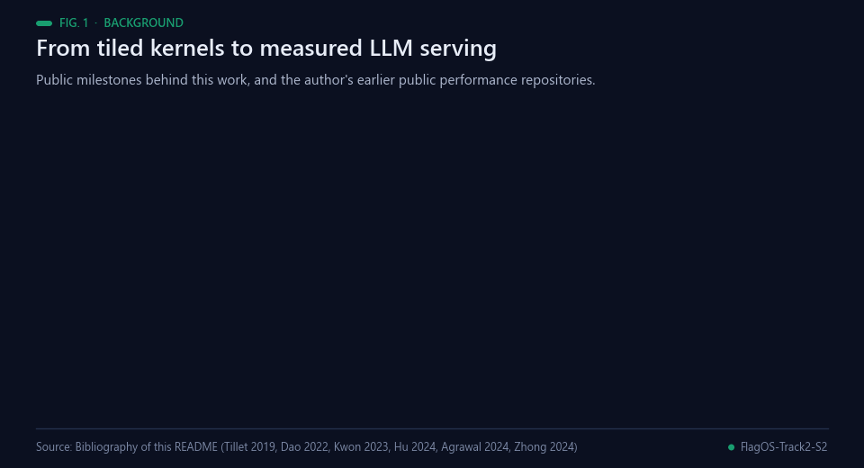<br><sub>Fig. 1 — Milestones behind this work. Sources: bibliography below.</sub></p>

Serving a language model combines kernel work and scheduling work. Triton [[1](#ref-1)] made tile-level GPU kernels
easy to write, and FlashAttention [[2](#ref-2)] showed how much a fused, memory-aware kernel can save. vLLM
[[3](#ref-3)] added PagedAttention for KV-cache memory, and later systems made the trade-offs between throughput, time
to first token (TTFT) and decode latency explicit: Sarathi-Serve [[5](#ref-5)] schedules chunked prefills, and DistServe
[[6](#ref-6)] separates prefill from decoding and defines goodput around TTFT and time per output token. The two
benchmark cases of this competition, a 4096-token and a 16384-token prompt at 64 concurrent requests, sit on that
trade-off. The served model, MiniCPM5-2B, belongs to the MiniCPM family of small language models [[4](#ref-4)].

The three prespecified arms target operators that every decoder layer runs: residual addition followed by RMSNorm
[[8](#ref-8)], and the SiLU-gated multiply of a gated feed-forward block [[9](#ref-9), [10](#ref-10)]. Whether such kernels help depends
on how memory-bound they are, which the roofline model [[7](#ref-7)] describes. The operators come from FlagGems
[[11](#ref-11)], selected through the `vllm-plugin-FL` plugin [[12](#ref-12)]; the competition fixes both. Accuracy is checked
on the Math500 Level 3 set [[13](#ref-13)], and the evidence rules follow common benchmarking practice: report the spread
over repeated runs [[14](#ref-14)] and prespecify the experiments before measuring [[15](#ref-15)].

This repository was published on 28 October 2026, the date of the RTX3090 baseline in the next section. It extends the
author's controlled-kernel evaluation workflow from [FlagOS-Track1-S2](https://github.com/Agnuxo1/FlagOS-Track1-S2) [[16](#ref-16)], which applies it to
Triton kernels in Track 1. Earlier public performance work by the author includes QueryFoundry, an entry for a Kaggle
database-performance challenge [[17](#ref-17)].

## Actual state, 28 October

<p align="center">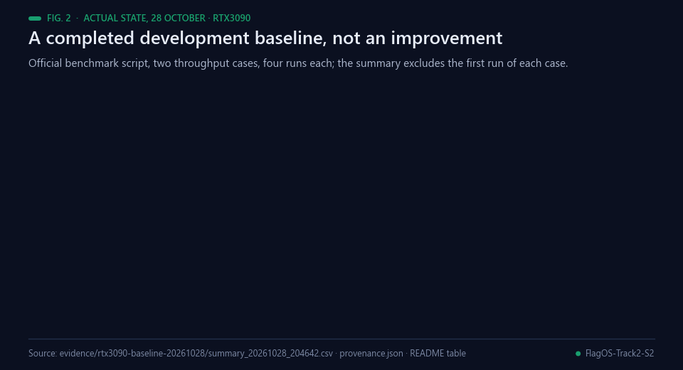<br><sub>Fig. 2 — The recorded RTX3090 development baseline. Data: evidence/rtx3090-baseline-20261028.</sub></p>

**The RTX3090 development baseline completed.** The official benchmark script
ran both throughput cases four times: one initial run and three runs used by
its fixed `SKIP_FIRST` summary rule. All eight raw runs completed every request.

| Prefill / decode / concurrency / requests | Mean output tokens/s | Mean TTFT (ms) |
|---|---:|---:|
| 4096 /1024 /64 /256 | **1190.38** | 4236.90 |
| 16384 /1024 /64 /128 | **238.61** | 152391.38 |

<p align="center">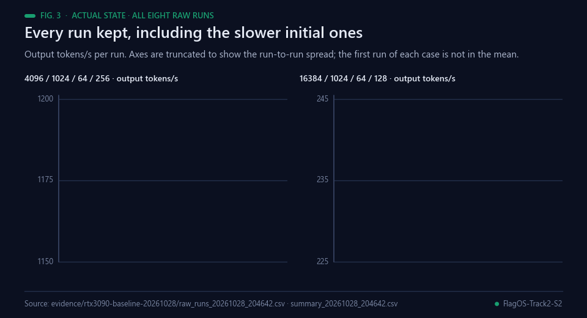<br><sub>Fig. 3 — All eight raw runs, the slower initial run of each case included (truncated axes). Data: raw_runs_20261028_204642.csv.</sub></p>

[All eight raw rows and the upstream summary](evidence/rtx3090-baseline-20261028)
are preserved, including the slower initial runs. The workload uses random
benchmark tokens, not an accuracy dataset. A shutdown `EngineDeadError` follows
SIGTERM after these completed measurements; it is recorded in provenance.
No throughput improvement, accuracy qualification or official score is claimed.
CUDA is a development proxy; official BI150/C500 measurements are still needed.

The current team plan targets **Track 1**. Track 2 stays prepared while the
one-track/team restrictions and official hardware allocation are resolved.
This public code is not a second competition registration or ZIP submission.

## Applied reliability improvements

<p align="center">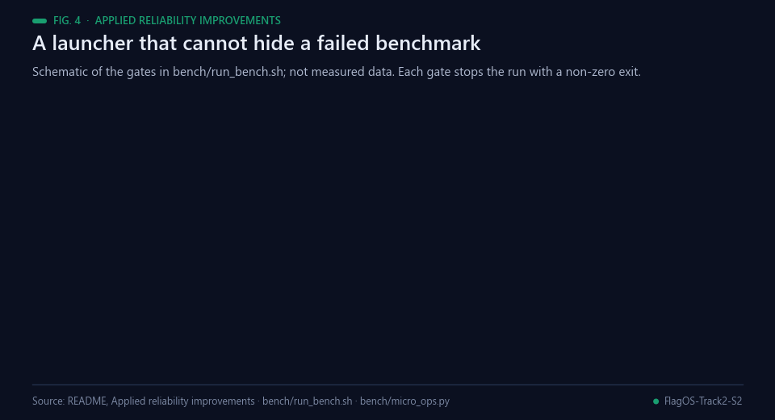<br><sub>Fig. 4 — Schematic of the gates in bench/run_bench.sh; not measured data.</sub></p>

- The launcher fails if its port is already occupied, the process exits, the
  model is not ready or the official benchmark fails. A final echo cannot hide
  a failed benchmark anymore.
- Readiness requires an HTTP-success response and the expected model ID.
- Logs, exact software versions and GPU information are preserved; cleanup
  addresses only the process launched by this script.
- The operator harness checks numerical correctness before timing. Its fused
  in-place case includes input clones in the measured cost, explicitly a
  call-level measurement rather than an isolated-kernel latency.

## Three prespecified experiment directions

<p align="center">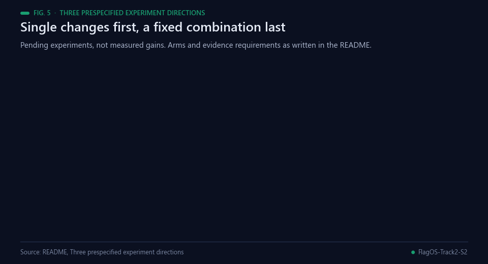<br><sub>Fig. 5 — The prespecified arms. Pending experiments, not measured gains.</sub></p>

| Arm | Single change | Required evidence |
|---|---|---|
| T2-E1 | Residual-add/RMSNorm tile geometry | Three seeds and launches, correctness, both official throughput cases |
| T2-E2 | SiLU/multiply launch geometry | Same model, dtype and arguments; no operator-selection bypass |
| T2-E3 | Fixed combination of individually qualified kernel changes | Compare with each single arm and upstream baseline |

<p align="center">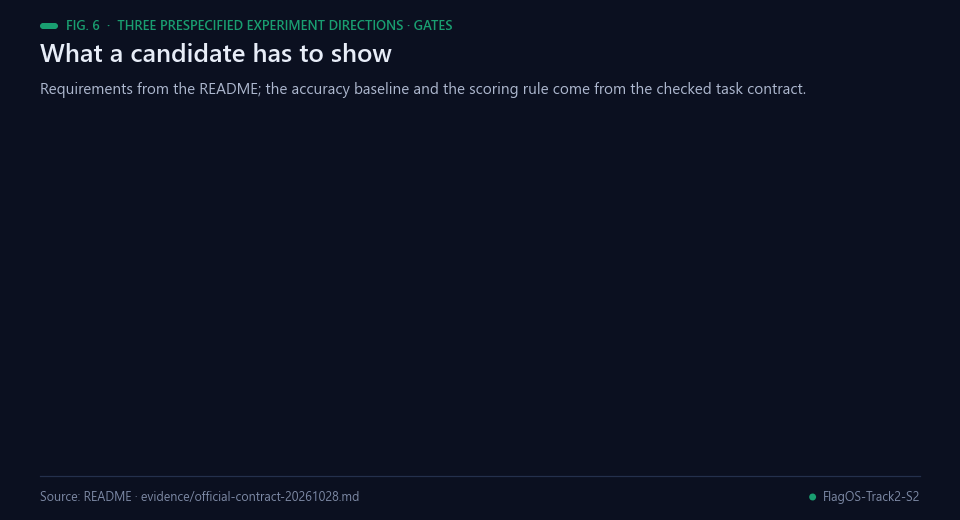<br><sub>Fig. 6 — Requirements for a candidate. Data: this README and evidence/official-contract-20261028.md.</sub></p>

These are **pending experiments**, not measured gains. Keep all failed cases
and regressions. Require Math500 Level3 accuracy >=0.95, TTFT no worse than
baseline+1%, and throughput improvement above the official 1% noise band.
No quantisation, speculative decoding, benchmark edits, model substitution or
serving-parameter tuning is introduced.

## Reproduce

<p align="center">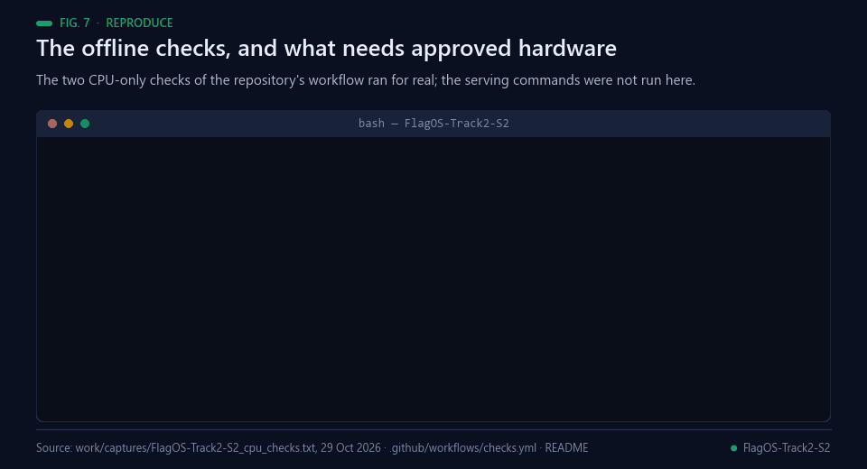<br><sub>Fig. 7 — A real offline run of the repository's two CI checks; the serving commands were not run.</sub></p>

The launcher uses the official Iluvatar argument profile. MetaX requires its
separate official profile (without the compilation-config argument), not this
launcher unchanged. Pin the official `flagos-2026-s2` branch (`13eb9be` at preparation) and
FlagGems v5.3.5, obtain the required model and approved hardware, then set
`FLAGOS_PROJECT_ROOT` to the isolated environment containing them:

```sh
bash bench/run_bench.sh E0_baseline_r1 '[[4096,1024,64,256],[16384,1024,64,128]]'
python bench/micro_ops.py --tag E0
```

Do not use a local GPU as an automatic fallback. Queue compatible proxy jobs
on servidor-ia and keep their scope distinct from official measurements.

## Real-world applications

<p align="center">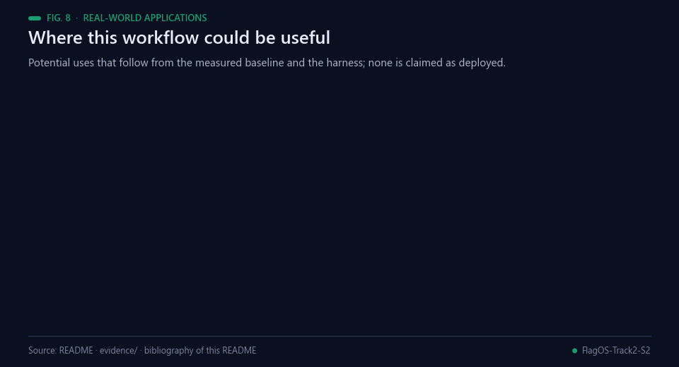<br><sub>Fig. 8 — Where this workflow could be useful. Potential uses only; none is claimed as deployed.</sub></p>

The launcher, the operator harness and the measured baseline suggest the following uses; each would need its own
confirmation on the target hardware.

- **Small-model serving.** A 2B-parameter model served with vLLM [[3](#ref-3)] on accelerators from several vendors.
- **Non-NVIDIA accelerators.** FlagGems operators [[11](#ref-11)] behind `vllm-plugin-FL` [[12](#ref-12)] on Iluvatar BI150 and
  MetaX C500, once approved hardware is available.
- **Capacity planning.** The baseline gives throughput and TTFT at 64 concurrent requests for 4096- and 16384-token
  prompts (1190.38 and 238.61 output tokens/s on an RTX3090 proxy), the quantities that scheduling studies
  [[5](#ref-5), [6](#ref-6)] reason about.
- **Fail-fast benchmarking.** A launcher that refuses to report a run whose server or benchmark failed can be reused by
  other teams.
- **Operator tuning.** Single-change experiments with every regression kept [[15](#ref-15)] are a template for kernel work
  [[1](#ref-1)].
- **Reproducible entries.** Pinned branches, logs and exact software versions let another team rerun a measurement.

## Possible improvements

<p align="center">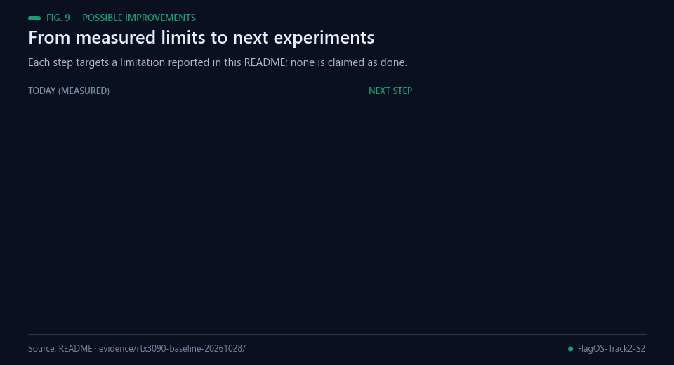<br><sub>Fig. 9 — Each improvement targets a limitation reported in this repository.</sub></p>

- **Official hardware.** The baseline ran on an RTX3090 development proxy; official BI150 and C500 measurements are
  still needed, with the official Iluvatar profile and the separate MetaX profile.
- **Accuracy alongside throughput.** The throughput runs use random benchmark tokens, not an accuracy dataset. Every
  candidate should be paired with the Math500 Level 3 check (accuracy of at least 0.95) [[13](#ref-13)] before throughput is
  compared.
- **Warm-up and the long-prompt queue.** The initial run of the 4096-token case is slower (1162.35 against 1188.77 to
  1192.16 output tokens/s), and the 16384-token case has a mean TTFT of 152391.38 ms at 64 concurrent requests. More
  launches would show how much of this is warm-up and how much is queueing [[5](#ref-5)], before any effect of about 1 % is
  judged [[14](#ref-14)].
- **Executing the arms.** T2-E1, T2-E2 and T2-E3 are prespecified but not yet run; each needs three seeds and launches,
  correctness checks and both official throughput cases, with every regression kept.

## Proposed next steps (not commitments)

<p align="center">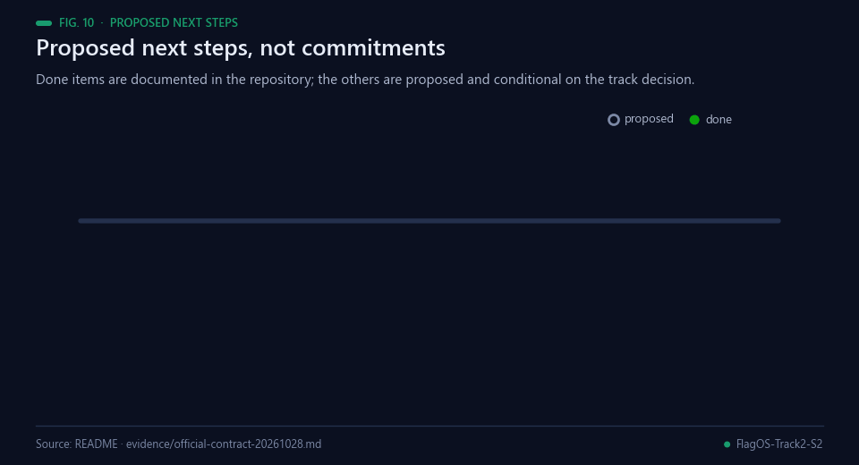<br><sub>Fig. 10 — Completed milestones are documented in this repository; the rest are proposed and conditional on the track decision.</sub></p>

Possible next steps, conditional on item 1 and not committed; none is started:

1. Resolve the one-track-per-team restriction and the official hardware allocation (the current team plan targets
   [Track 1](https://github.com/Agnuxo1/FlagOS-Track1-S2)).
2. Run T2-E1 and T2-E2 as single-change arms, with three seeds and launches each.
3. Run T2-E3 only from individually qualified changes, and compare it with each single arm and the baseline.
4. Repeat the baseline and the qualified arms on official BI150 and C500 hardware, if hardware is allocated.
5. Possible: check whether the `EngineDeadError` that follows SIGTERM at shutdown can be avoided (for example by a
   graceful stop); its cause is not established.

## Dates, sources and licence

<p align="center">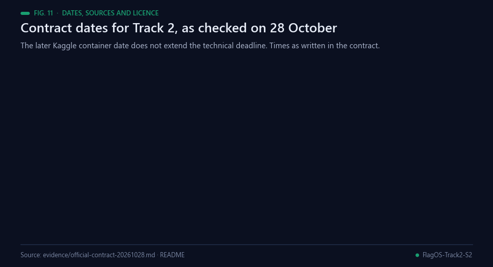<br><sub>Fig. 11 — Dates as written in the checked task contract; milestones not to scale.</sub></p>

The [checked task contract](evidence/official-contract-20261028.md) gives
registration/compute application closing10November and technical delivery
20November23:59UTC+8 (16:59Madrid). The later Kaggle container date does not
extend that technical deadline. A compute application also needs the required
team/CV information; none is invented here.

Own harness code: Apache-2.0. Upstream FlagGems, vLLM, the model and
`vllm-plugin-FL` retain their own licences. Their source, weights, credentials
and competition data are not redistributed by this repository.

## Bibliography

1. <a id="ref-1"></a>Tillet, P., Kung, H. T., & Cox, D. (2019). Triton: an intermediate language and compiler for tiled neural network computations. *Proceedings of the 3rd ACM SIGPLAN International Workshop on Machine Learning and Programming Languages*, 10–19. https://doi.org/10.1145/3315508.3329973
2. <a id="ref-2"></a>Dao, T., Fu, D. Y., Ermon, S., Rudra, A., & Ré, C. (2022). FlashAttention: Fast and Memory-Efficient Exact Attention with IO-Awareness. *arXiv* 2205.14135. https://arxiv.org/abs/2205.14135
3. <a id="ref-3"></a>Kwon, W., Li, Z., Zhuang, S., et al. (2023). Efficient Memory Management for Large Language Model Serving with PagedAttention. *arXiv* 2309.06180. https://arxiv.org/abs/2309.06180
4. <a id="ref-4"></a>Hu, S., Tu, Y., Han, X., et al. (2024). MiniCPM: Unveiling the Potential of Small Language Models with Scalable Training Strategies. *arXiv* 2404.06395. https://arxiv.org/abs/2404.06395
5. <a id="ref-5"></a>Agrawal, A., Kedia, N., Panwar, A., et al. (2024). Taming Throughput-Latency Tradeoff in LLM Inference with Sarathi-Serve. *arXiv* 2403.02310. https://arxiv.org/abs/2403.02310
6. <a id="ref-6"></a>Zhong, Y., Liu, S., Chen, J., et al. (2024). DistServe: Disaggregating Prefill and Decoding for Goodput-optimized Large Language Model Serving. *arXiv* 2401.09670. https://arxiv.org/abs/2401.09670
7. <a id="ref-7"></a>Williams, S., Waterman, A., & Patterson, D. (2009). Roofline: an insightful visual performance model for multicore architectures. *Communications of the ACM*, 52(4), 65–76. https://doi.org/10.1145/1498765.1498785
8. <a id="ref-8"></a>Zhang, B., & Sennrich, R. (2019). Root mean square layer normalization. *Advances in Neural Information Processing Systems 32 (NeurIPS 2019)*. https://arxiv.org/abs/1910.07467
9. <a id="ref-9"></a>Shazeer, N. (2020). GLU Variants Improve Transformer. *arXiv* 2002.05202. https://arxiv.org/abs/2002.05202
10. <a id="ref-10"></a>Elfwing, S., Uchibe, E., & Doya, K. (2017). Sigmoid-Weighted Linear Units for Neural Network Function Approximation in Reinforcement Learning. *arXiv* 1702.03118. https://arxiv.org/abs/1702.03118
11. <a id="ref-11"></a>FlagOS contributors (2026). *FlagGems* [Software repository]. GitHub. https://github.com/flagos-ai/FlagGems
12. <a id="ref-12"></a>FlagOS contributors (2026). *vllm-plugin-FL* [Software repository]. GitHub. https://github.com/flagos-ai/vllm-plugin-FL
13. <a id="ref-13"></a>Lightman, H., Kosaraju, V., Burda, Y., et al. (2023). Let's Verify Step by Step. *arXiv* 2305.20050. https://arxiv.org/abs/2305.20050
14. <a id="ref-14"></a>Hoefler, T., & Belli, R. (2015). Scientific benchmarking of parallel computing systems. *Proceedings of the International Conference for High Performance Computing, Networking, Storage and Analysis*, 1–12. https://doi.org/10.1145/2807591.2807644
15. <a id="ref-15"></a>Nosek, B. A., Ebersole, C. R., DeHaven, A. C., & Mellor, D. T. (2018). The preregistration revolution. *Proceedings of the National Academy of Sciences*, 115(11), 2600–2606. https://doi.org/10.1073/pnas.1708274114
16. <a id="ref-16"></a>Angulo de Lafuente, F. (2026). *FlagOS Track1 S2: controlled Triton kernels* [Software repository, Apache-2.0 licence]. GitHub. https://github.com/Agnuxo1/FlagOS-Track1-S2
17. <a id="ref-17"></a>Angulo de Lafuente, F. (2026). *QueryFoundry: verifiable performance and durable recovery* [Software repository, Apache-2.0 licence]. GitHub. https://github.com/Agnuxo1/QueryFoundry

---

<div align="center">
<sub>Built by <a href="https://github.com/Agnuxo1">Francisco Angulo de Lafuente</a> · every figure is an animated
rendering of the published file named in its footer · <a href="#flagos-season-2-track-2-measured-minicpm5-2b-optimisation">back to top ↑</a></sub>
</div>
